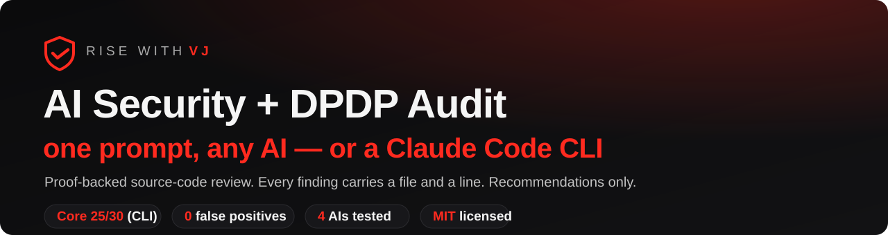
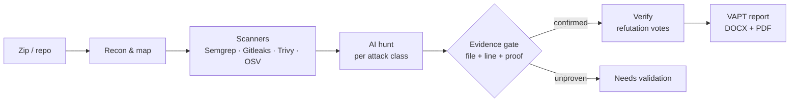
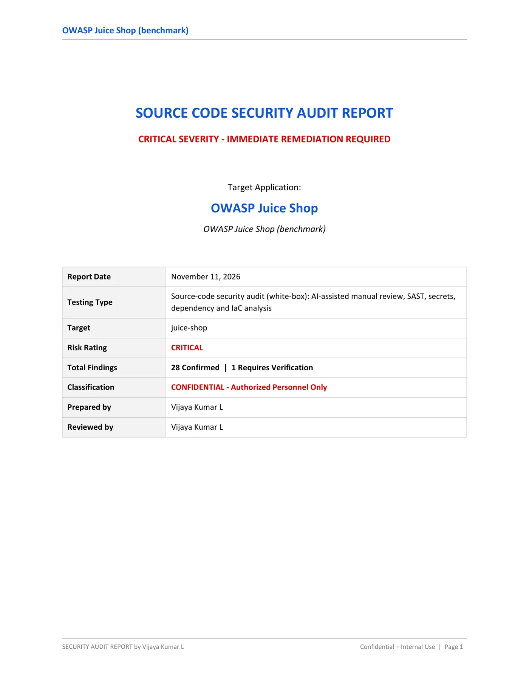
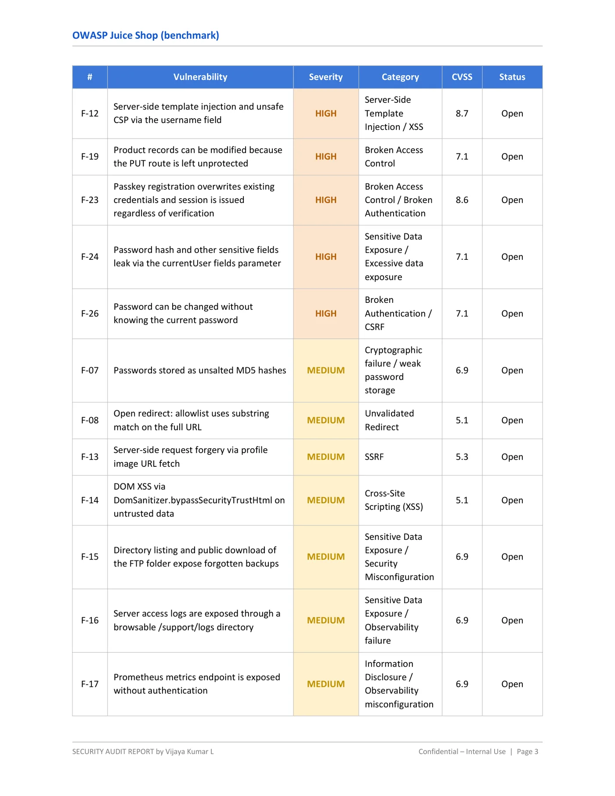
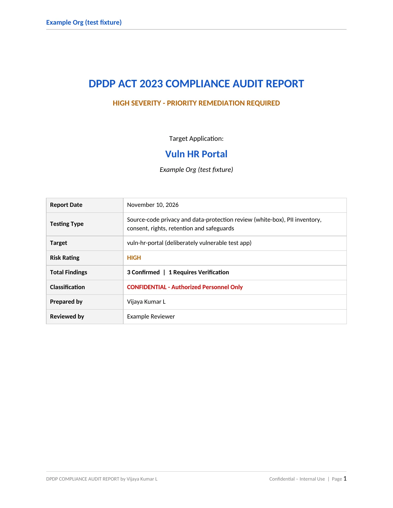

<!--
  AI-Security-Audit-Skills
  Author   : Vijaya Kumar L  (Rise With VJ)
  GitHub   : https://github.com/risewithvj
  LinkedIn : https://www.linkedin.com/in/vijayakumarl/
  License  : MIT
-->

<div align="center">



[](https://github.com/risewithvj/AI-Security-Audit-Skills/releases)
[](https://github.com/risewithvj/AI-Security-Audit-Skills/actions/workflows/ci.yml)
[](LICENSE)
[](https://github.com/risewithvj/AI-Security-Audit-Skills/stargazers)
[](https://risewithvj.github.io/AI-Security-Audit-Skills/)

**[🌐 Open the prompt studio](https://risewithvj.github.io/AI-Security-Audit-Skills/) · [📊 Benchmark scorecard](https://risewithvj.github.io/AI-Security-Audit-Skills/benchmark/juice-shop-web-ai.html) · [🧾 Sample report](examples/sample-security-audit-report.pdf)**

</div>

---

## What it is

A **proof-backed source-code security (VAPT) + India DPDP audit** you run two ways: paste **one prompt** into any AI with your project zip, or install the **Claude Code** skills and ask it to audit the repo. Every confirmed finding carries **file-and-line evidence**; it is **recommendations only** and never modifies your code.

> **No case, no finding. No proof, no severity. No guess, ever.**

**Jump to:** [How it works](#how-it-works) · [Prompts](#prompts) · [DPDP](#dpdp) · [Benchmark](#benchmark) · [Sample reports](#sample-reports) · [CLI install](#cli-install) · [Roadmap](#roadmap) · [FAQ](#faq)

---

## How it works



Read-only and source-only: the engine reads code and runs the bundled scanners; it never runs, serves, or contacts your app.

---

## Prompts

Open the **[prompt studio](https://risewithvj.github.io/AI-Security-Audit-Skills/#prompts)** and pick your stack (11 types) and a tier — then **Copy** or **Download `.txt`**:

| Tier | For | What it does |
|---|---|---|
| **Lite** | free / smaller AIs | Top risks, one-page report. |
| **Pro** | paid AIs | Full VAPT + browser-console tampering + DPDP when PII is found. |
| **God** | paid AIs | Pro + self-refutation, risk chains, impact scenario, fix-priority roadmap. |
| **Deep (4-pass)** | paid AIs, best coverage | Four focused passes in one chat — send pass 1, reply "next". |

Zip your project (drop `.git`, `node_modules`, builds — never `.env`), attach, paste, send. Nothing runs on your machine and your code is sent nowhere by the prompt.

---

## DPDP

A dedicated **India DPDP Act 2023 + DPDP Rules 2025** audit (`/ai-dpdp-audit`, or `TYPE=dpdp` in the web prompt). It maps where personal data is collected, stored, logged, shared, retained and erased, then checks notice, consent, purpose limitation, security safeguards (Rule 6), breach readiness (Rule 7), retention/erasure (Rule 8), Data-Principal rights, children's data and cross-border transfer — against your actual code. Auto-folds into a security run when PII is found.

---

## Benchmark

Fresh **v1.5.1** run on **OWASP Juice Shop**, scored against a **mechanically-frozen Core 30** (picked from Juice Shop's own categories/tags before scoring — [the rule](tests/benchmark/core30.md)). Same rules for every tool.

| Tool | Core / 30 | Full / 60 (strict) | Full / 60 (coverage) | False positives |
|---|:---:|:---:|:---:|:---:|
| **AISA CLI (this engine)** | **25** | **46** | **53** | 0 |
| Codex (web) | 11 | 23 | 46 | 0 |
| Claude.ai (web, partial) | 10 | 23 | 45 | 0 |
| ChatGPT (web) | 7 | 18 | 48 | 0 |
| Gemini Pro (web) | — refused — | | | |
| **Web-AI union** | **14** | **29** | **53** | 0 |

On the Core 30 the CLI found **more than twice** any single web AI and **more than all three combined**. On the looser coverage metric the field is close — the engine's edge is **precision and completeness**. **0 false positives** across every tool **on Juice Shop** (a deliberately vulnerable app, so this measures precision only on known-vulnerable code). Honest caveats: **Claude.ai** was partial (~40 routes, client-side not reached, 31% of session usage); **Codex** used the softer defensive prompt; **Gemini Pro** refused.

**→ [Full scorecard](https://risewithvj.github.io/AI-Security-Audit-Skills/benchmark/juice-shop-web-ai.html)** · **[Executive one-pager (PDF)](https://risewithvj.github.io/AI-Security-Audit-Skills/benchmark/executive-scorecard.pdf)**

---

## Sample reports

<div align="center">




**[Security report (PDF)](examples/sample-security-audit-report.pdf)** · **[DPDP report (PDF)](examples/sample-dpdp-audit-report.pdf)** · [open the viewer on the site →](https://risewithvj.github.io/AI-Security-Audit-Skills/#reports)
</div>

Each confirmed finding includes location, plain-English summary, business impact, root cause, the **source trace with file and line**, the smallest safe fix with code, what the fix could break, a regression test, CWE, OWASP/API/LLM mapping, CVSS 4.0, and verifier votes.

---

## CLI install

**Windows (PowerShell)**
```powershell
git clone https://github.com/risewithvj/AI-Security-Audit-Skills; powershell -ExecutionPolicy Bypass -File .\AI-Security-Audit-Skills\install\install.ps1
```
**macOS / Linux (bash)**
```bash
git clone https://github.com/risewithvj/AI-Security-Audit-Skills && bash AI-Security-Audit-Skills/install/install.sh
```

Add `-WithScanners` / `--with-scanners` to bundle Semgrep + Gitleaks. Then in Claude Code: *"run a full security audit of this project"* (or *"a DPDP audit"*). No install at all? See **[START.md](START.md)**.

| | Skill | What it does |
|---|---|---|
| 🔍 | **`/ai-security-audit`** | White-box source audit of any stack — web, API, mobile, cloud/IaC, AI/LLM, MCP |
| 🇮🇳 | **`/ai-dpdp-audit`** | India DPDP Act 2023 + Rules 2025 audit |

---

## Roadmap

- [x] **v1.7** — new landing page: prompt studio, DPDP section, roadmap, report viewer, Docs menu
- [x] **v1.6** — landing + analytics, README redesign, HD images, GitHub polish
- [x] **v1.5** — tiered web prompts, lean auto-profile CLI, mechanical Core 30 benchmark, web-AI scorecard
- [ ] Optional live staging verification (OWASP ZAP) behind an explicit authorization gate
- [ ] Fix-branch helper: one finding per commit with regression tests, then auto re-audit
- [ ] SARIF export for GitHub code scanning

---

## FAQ

<details><summary><b>Is my code safe?</b></summary>Yes — read-only and recommendations only; nothing is modified, and the web prompt runs inside the AI you already use. Strip <code>.env</code> and real secrets before zipping.</details>
<details><summary><b>Free vs paid AI?</b></summary>Free/smaller AIs get <b>Lite</b> (top risks, one page). Paid tiers run <b>Pro</b>, with <b>God</b> and the <b>Deep 4-pass</b> for the deepest review.</details>
<details><summary><b>Why zero false positives?</b></summary>Juice Shop is deliberately vulnerable, so "0 FP" there measures precision only on known-vulnerable code — not real-world noise. Every finding still needs file-and-line proof.</details>
<details><summary><b>Does it fix my code?</b></summary>No. It describes the smallest safe fix for each finding; your project is never changed.</details>
<details><summary><b>What is DPDP?</b></summary>India's Digital Personal Data Protection Act 2023 (+ Rules 2025). See the <a href="#dpdp">DPDP section</a>.</details>

---

## Contributing & security

Issues and PRs welcome — templates included (bug, false positive, feature, new stack). See **[CONTRIBUTING.md](CONTRIBUTING.md)**. Report vulnerabilities per **[SECURITY.md](SECURITY.md)**. Audit only code you own or are authorized to review.

---

<div align="center">

**Vijaya Kumar L** · *Rise With VJ* — Lead, Application Engineering

[](https://github.com/risewithvj)
[](https://www.linkedin.com/in/vijayakumarl/)

If this saved you a week of security review, **⭐ star the repo** so other builders find it.

<sub>© 2026 Vijaya Kumar L · risewithvj · MIT License</sub>

</div>
